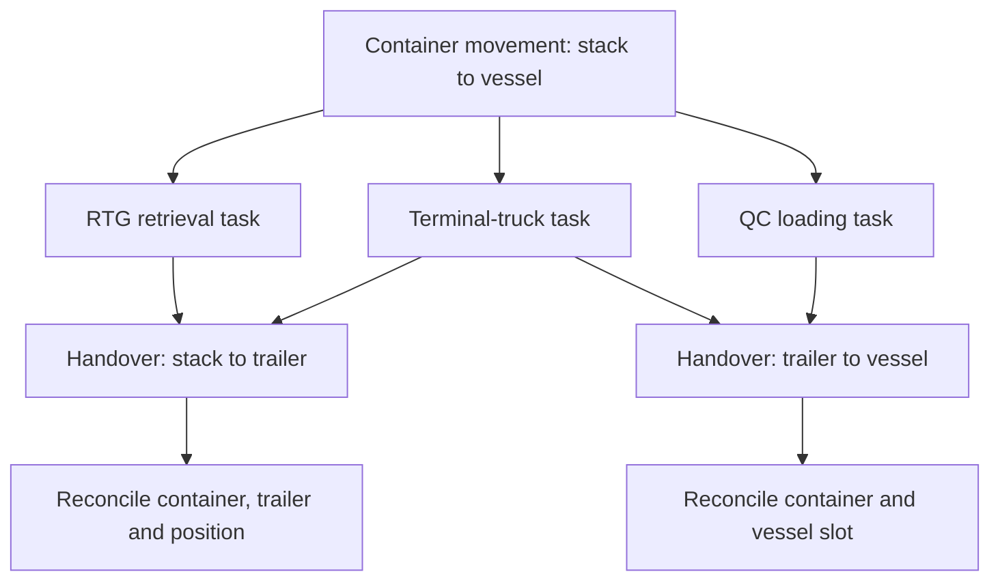

# RTG terminal operations: job lifecycle, decision authority and comparative evidence

**Version:** 0.1  
**Research date:** 24 October 2026 (Asia/Shanghai)  
**Status:** Research synthesis ready for owner review; terminal-specific validation remains open.  
**Scope:** Salalah (anchor), PTP Malaysia, APMT Tangier TC1 Morocco and GTI Mumbai India.

## 1. Findings and reading guide

An RTG terminal is best understood through linked cargo movements, equipment tasks, decisions and confirmations. A label such as manual, electric or automated is insufficient to describe those relationships.

The evidence supports these conclusions:

1. RTG-based yards can combine human-operated handling with software-based allocation and prioritization. Salalah and PTP provide different evidence for this combination. [S01-S04]
2. Job selection, physical execution and confirmation should be investigated separately. Historical PTP procedures provide concrete examples, but cannot establish today's configuration. [S05]
3. Internal-truck optimization and external-truck arrival/release control are different mechanisms. PTP and Mumbai offer complementary examples. [S06, S11-S12]
4. Mechanical availability, working-cycle performance and coordination deserve separate measurement. TC1 provides maintenance and cycle-improvement evidence. [S08-S09]
5. The evidence does not yet establish a complete current shift organization, operator discretion or handover event implementation at any of the four terminals.

Read Sections 2-3 for evidence; Sections 4-10 for the analytical model and worked scenarios; Sections 11-13 for reconciliation and final review. This is a general operations reference, not a VZJ project design or an approved terminal SOP. No live terminal system was accessed.

## 2. Method and evidence boundaries

### 2.1 Classification

| Label | Meaning |
| --- | --- |
| E | A retrieved source explicitly reports a fact or capability. This establishes the publication's statement, not independent operational verification. |
| H | Historical procedural evidence whose current applicability is unverified. |
| I | An inference connecting evidence; limitations are stated. |
| M | An original analytical model, proposed research definition or synthetic scenario. It is not attributed to a terminal. |
| U | Unresolved by the reviewed public evidence. |

Operator statements, supplier statements and independent measurements are distinguished. A supplier release quoting a customer remains supplier-published evidence. A terminal-hosted press reprint remains a reprint.

The user's earlier descriptions of roles and functional allocation were deliberately excluded as evidence, following the instruction to construct an independent understanding. No organizational allocation is derived from TIC 4.0 terminology.

### 2.2 Terminal identity and inclusion

| Terminal | APMT relationship and RTG inclusion evidence | Comparison purpose |
| --- | --- | --- |
| Salalah, Oman | APMT-associated anchor; hybrid RTG operator-support features documented. [S01] | Assisted crane operation, dispatching and asset visibility |
| Port of Tanjung Pelepas (PTP), Malaysia | MMC/APMT joint venture; RTG optimization implementation and further eRTG deliveries documented. [S04, S14] | Fleet coordination and terminal-truck integration |
| APM Terminals Tangier TC1, Morocco | TC1 RTG additions confirmed by Tanger Med. [S07] | Operations-Maintenance coordination and cycle performance |
| Gateway Terminals India (GTI), Mumbai, India | APMT/CONCOR joint venture; terminal profile identifies GPS-assisted RTGs and separate rail cranes. [S10] | Road/rail gateway interfaces and external-truck flow |

RTG configuration is confirmed. Cabin versus remote operation, automated subfunctions, and commissioning coverage must be checked at equipment and date level. No blanket claim is made that every crane in every fleet is manually operated.

APMT MedPort Tangier is a different facility: its published expansion uses automated rail-mounted yard cranes and shuttle carriers. It is excluded from the RTG comparison. [S13]

## 3. Evidence register: what is established

### 3.1 Salalah

**E-SAL-01 (E):** The hybrid RTG announcement describes dGPS, position determination, automatic gantry steering as operator support, and operator training. Hybrid power and operator assistance are separate attributes. [S01]

**E-SAL-02 (E):** The port-branded presentation hosted in the SLL2025 conference collection describes RTG Optimizer as semi-automated yard dispatching, including equipment-range allocation and job-list prioritization. It also describes equipment position/health visibility, a shared vessel-preparation checklist and schedule import into the TOS. ACE integration benefits use future-tense wording; they are not treated as proof of completed integration. The presentation identifies Port Mirror as a simulation tool connected to terminal and shipping-line systems. Exact production coverage and override rules remain unknown. [S02, PDF pp. 6-7]

### 3.2 PTP

**E-PTP-01 (E):** A 2022 terminal-hosted WorldCargo News reprint describes work-zone setting, job ordering and advance fleet positioning as coordination challenges. Objectives included more exception-focused control-room work and preparation of buried loading containers before truck arrival. These are published objectives, not measured achieved results. [S03]

**E-PTP-02 (E):** Navis separately announced successful implementation of RTG Optimization in September 2022. Its statement supports implementation, not access to the deployed rules or configuration. [S04]

**E-PTP-03 (H):** PTP's Terms and Conditions of Business, 3rd Edition 2020, includes liner procedures. Section 2.1.1.3 describes truck routing producing an RTG delivery instruction containing truck identity (printed p. 113; PDF p. 117). Section 2.2.2 describes a prime mover following its VMT location and the RTG stacking and confirming (printed pp. 119-120; PDF pp. 123-124). Section 3.6.3 assigns Cargo Control load-list locking and requires terminal Operations Management and Vessel Operator approval for late requests (printed p. 131; PDF p. 135). Section 3.6.5 assigns reconciliation of stowage and release instructions to Planning (printed p. 132; PDF p. 136). These are historical responsibilities, not verified current deadlines or rules. [S05]

**E-PTP-04 (E, supplier-reported):** Kaleris's June 2025 release identifies PTP as a Terminal Truck Optimization adopter working with RTG-O and N4. It reports 13% shorter truck cycle time and 20% lower QC waiting time, among other results. Baseline, attribution and measurement definitions are unavailable; these percentages are not transferred into our model or treated as independent causal evidence. [S06]

**E-PTP-05 (E, ordered specification):** Mitsui's February 2024 order announcement specifies bus-bar power during handling and a battery for block-to-block gantry travel. An ordered design is not proof that every ordered machine is commissioned or every block compatible. [S15]

### 3.3 Tangier TC1

**E-TC1-01 (E, historical fleet snapshot):** Tanger Med reported three additional RTGs in June 2021, increasing TC1's fleet from 23 to 26 at that date. [S07]

**E-TC1-02 (E, operator-reported):** TC1 describes SCADA functions for equipment-health monitoring, remote troubleshooting and preparing parts/tools. These support diagnostic capability, not a conclusion about remote container handling. [S08]

**E-TC1-03 (E, operator-reported):** A 2024 post describes an Operations/Asset Management exercise targeting a 5% improvement in RTG net cycle time through engineering work including spreader path and speed. The post does not establish a measured achieved 5% RTG gain. [S09]

### 3.4 GTI Mumbai

**E-GTI-01 (E, published profile):** APMT's terminal profile lists 40 GPS-assisted RTGs and separately identifies rail-mounted cranes. It is a published inventory, not an on-site fleet audit. [S10]

**E-GTI-02 (E):** A September 2025 announcement says TAS went live on 29 September, using entry time slots to regulate arrivals. An October advisory describes FGS using SMS yard instructions and staging excess trucks until RTGs can serve them. These are different control points; neither source establishes a measured end-to-end waiting-time reduction. [S11-S12]

### 3.5 Organization and maintenance corroboration

**E-ORG-01 (E, undated/legacy careers page):** PTP's own careers page describes a maintenance Shift Coordinator recording outages, coordinating technicians/supporting equipment and preparing handovers. It separately describes Technical Planning and an RTG Management Team Leader. This supports distinct maintenance coordination/planning responsibilities, not a complete current reporting chart. [S16]

## 4. Operational model: movement, task, instruction and event

**M throughout this section.** These definitions organize investigation; they are not vendor-native object names.

| Object | Proposed meaning | Example |
| --- | --- | --- |
| Cargo movement | Intended relocation of a container between operational endpoints | Stack position to vessel slot |
| Equipment task | One resource's contribution to that movement | RTG retrieval; truck transport; QC loading |
| Instruction | A communicated direction with identifiable scope and revision | Truck proceed to service position; RTG retrieve a specified unit |
| Assignment | Association of a task with a resource | Retrieval assigned to RTG-A |
| Physical event | Observed change in the real operation | Container set down on trailer |
| System event | Recorded information about a change | Retrieval completion received by TOS |
| Authorization | Permission for a specified action or change | Approved late loading-list amendment |
| Exception | A condition requiring a different path or intervention | Wrong container at expected position |

A business release does not itself prove that an equipment instruction has been dispatched. A dispatched instruction does not prove that lifting started. A physical handover and its system confirmation can occur at different times.

### 4.1 Proposed task lifecycle

| State | Meaning in this model | Evidence needed to recognize it |
| --- | --- | --- |
| Created | Work exists as an identifiable task | Task ID, intended endpoints and parent movement |
| Eligible | Required business, physical and resource conditions pass | Eligibility result and reasons |
| Assigned | A resource is selected | Resource ID and assignment revision |
| Released | Instruction is delivered for execution | Delivery/dispatch record |
| Acknowledged | Recipient recognizes the instruction, if supported | Acknowledgment or an explicit unavailable flag |
| Executing | Physical execution has begun | Operator confirmation or qualified equipment observation |
| Physically completed | Intended handling action has occurred | Destination and handover observation |
| Recorded completed | Responsible operational system accepts completion | Accepted transaction and resulting location/status |
| Reconciled | Conflicting or delayed evidence is resolved | Resolution record when required |

This is a conceptual sequence. Systems may combine or omit states. Eligibility can be lost, assignments revised, and acknowledgment may not exist. Physical and recorded completion should be represented separately rather than forced into one linear status field.

Hold, cancellation, failure and supersession are alternative paths. Cancellation after a physical action does not reverse that action; subsequent handling requires a new or revised movement record.

### 4.2 Three linked tasks in vessel loading

The diagram represents dependencies, not a prescribed dispatch order. Truck unladen travel and RTG preparation may overlap. A task's end boundary, such as whether truck completion occurs at quay arrival or after QC pickup, must be defined locally.

## 5. Decision authority: supported fragments and proposed allocation

### 5.1 What public evidence can establish

PTP's historical procedural roles are recorded in E-PTP-03. The four terminals' public material does not establish a common current authority matrix. Product names, department names and job titles cannot fill that gap.

The following is **M: a candidate allocation for review**, not an APMT organization chart.

| Decision | Candidate accountable function | Supporting contribution | Boundary requiring local confirmation |
| --- | --- | --- | --- |
| Nominate container to vessel | Authorized cargo/vessel interests and terminal cargo-control process | Data validation | Which party may change commercial nomination |
| Decide stowage and loading work | Vessel/terminal planning functions | Vessel information, yard feasibility | Ship approval and late-change rules |
| Select yard storage strategy | Yard planning function | Space/cargo constraints and system rules | Strategy approval versus individual slot selection |
| Allocate RTG coverage | Live operations coordination | Optimizer and equipment availability | Automatic authority and override rights |
| Assign/prioritize tasks | Configured dispatch process | TOS/optimizer and frontline information | Who can commit, reject, reorder or suspend |
| Perform handling | Competent equipment operator/control function | Instruction, observation and equipment controls | Exact safe-start and completion conditions |
| Diagnose and repair | Engineering/maintenance function | Operator fault report and condition data | Isolation, testing and technical release |
| Return resource to service | Locally designated technical and operational authorities | Test result, restrictions and staffing | Technical readiness versus operational acceptance |
| Resolve conflicting movement records | Authorized operational data owner | Operator, equipment and system evidence | Who may correct location and close tasks |

Software can execute a delegated decision while people retain responsibility for configuring and supervising that delegation. The delegation itself needs evidence.

### 5.2 Proposed override record

For an overridden assignment or sequence, capture: original instruction and revision; reason; initiator; required authorization; affected resources; physical state when changed; replacement instruction; acknowledgment where available; and resulting location.

Research must distinguish authorized discretion from undocumented workarounds. A changed radio instruction should not silently coexist with an active screen instruction.

## 6. RTG operation, layout and resource feasibility

**M: an analytical breakdown.**

The physical handling cycle should distinguish identification, positioning/alignment, engagement, hoist, trolley transfer, lowering, disengagement and confirmation. Some motions may overlap; they are not additive standard times. Gantry travel along a block, relocation between blocks, waiting and reshuffles require separate treatment.

This is a process vocabulary for observation, not a crane operating instruction. Interlocks, permissible movements and personnel-clearance rules require the actual equipment manual and approved local SOP.

### 6.1 Feasibility questions before prioritization

| Dimension | Questions to test |
| --- | --- |
| Container | Is identity correct, location trustworthy and the target accessible? |
| Storage | Are destination, tier and surrounding stack conditions compatible? |
| Crane | Is it serviceable, staffed, capable and permitted to serve the location? |
| Power and movement | Is the route compatible with this machine's power/mobility configuration? |
| Truck/trailer | Is the identified combination present, suitable and ready for transfer? |
| Work area | Are lanes, adjacent equipment and work restrictions compatible? |
| Downstream | Can the receiving operation accept the container within the intended sequence? |
| Instruction | Is the recipient acting on the current authorized revision? |

Mitsui's ordered power configuration illustrates why electrification and relocation feasibility need separate investigation. [E-PTP-05] It does not quantify relocation time or establish a universal eRTG restriction.

### 6.2 Slotting and reshuffles

Candidate slotting variables include outbound connection, discharge port, container dimensions, weight, cargo restrictions, expected dwell, block accessibility and resource demand. Their relative importance and implemented rule set remain site-specific.

Evaluate preparatory reshuffles against total handling effort, workload and changed plans. Exposing a near-term load container can help, but speculative rearrangement can create additional work if its departure plan changes. Avoid assuming every reshuffle is waste or every preparatory move is beneficial.

A block should be modeled as shared space with traffic, stack access and crane-interference constraints, not merely as a quantity of storage slots.

## 7. Worked exercise: one RTG with competing demand

**M: entirely synthetic.** IDs, priorities and outcomes below are invented for reasoning. There is no terminal performance measurement or simulated optimization result.

An RTG serving Block-B has:

| Task | Work | Initial condition |
| --- | --- | --- |
| L1 | Retrieve a vessel-loading container | Buried; loading window approaching |
| D1 | Stack a vessel-discharge container | Laden terminal truck waiting |
| G1 | Deliver a container to an external truck | Truck waiting in staging |
| P1 | Preparatory reshuffle for L1 | Destination available in the assumed layout |

### 7.1 Decision sequence

1. Validate identities, current instructions, restrictions and feasible handling paths.
2. Assess downstream urgency and consequences: QC supply, discharge-truck occupancy, external service commitments and impending congestion.
3. Compare feasible sequences including required travel and P1. Queue age alone is insufficient.
4. Commit only the next suitable instructions, preserving a defined revision and cancellation boundary.
5. Release or hold trucks consistently with the selected sequence.
6. Update expected completion and reassess when a material event occurs.

There is no universal rule that vessel work always takes precedence. In one illustrative branch D1 clears a scarce truck and lane before P1/L1; in another, the imminent loading requirement justifies P1/L1 first. Both require explicitly different assumptions.

### 7.2 Disruption: the RTG fails

| Step | Proposed response in the model | Authority/data issue |
| --- | --- | --- |
| Contain | Suspend affected instructions under local safe procedures | Distinguish queued work from a container already engaged or suspended |
| Establish state | Record actual container, equipment and truck state | Do not derive physical state only from the last TOS status |
| Assess recovery | Obtain fault assessment and restrictions | Estimate return time with uncertainty |
| Compare options | Wait, use another reachable RTG, change coverage, or revise downstream work | Include relocation and impact on the substitute crane's existing jobs |
| Authorize | Obtain approvals required for plan/assignment changes | Separate operational resequencing from vessel/cargo changes |
| Communicate | Supersede old instructions and direct affected resources | Prevent duplicate or contradictory assignments |
| Recover | Execute approved feasible work and reconcile records | Close each task according to its own completion boundary |

TC1 and PTP evidence motivates these questions; it does not verify this recovery procedure at Salalah.

### 7.3 Additional tabletop branches

| Branch | Proposed acceptance criterion |
| --- | --- |
| Container physically moved; network confirmation delayed | Preserve both event and receipt times; no duplicate handling caused by a missing acknowledgment |
| Wrong container observed at expected slot | Hold the affected action and resolve identity/location through authorized workflow |
| Vessel nomination changes after retrieval | Preserve actual trailer location; identify who can approve a revised destination |
| Truck breaks down after RTG pickup is complete | Retrieval remains complete; transport recovery becomes a distinct exception |
| Duplicate completion arrives | Original completion remains traceable; duplicate processing does not move inventory twice |
| New shift takes over with outstanding exceptions | Incoming function accepts explicit unresolved-task and restriction records |

These are reasoning criteria, not executed terminal tests.

## 8. Proposed operational data model and event reconciliation

**M: a research instrument, not an implemented adapter or a TIC 4.0/PAS schema.**

### 8.1 Minimum fields to examine

| Group | Candidate fields |
| --- | --- |
| Identity | Terminal, movement ID, task ID, container ID, vessel-call ID |
| Resources | RTG, truck, trailer and QC IDs separately |
| Location | Source, intended destination and observed actual location |
| Instruction | Revision, assignment, issue time, recipient, supersession reference |
| State | Task status, cargo eligibility, equipment condition and restrictions separately |
| Event | Event ID, event type, event time, receipt time, producer and observation method |
| Evidence quality | Confirmed/estimated/unknown, clock quality and correction history |
| Authority | Actor/function, approval reference and override reason |
| Exception | Category, owner, next action, expiry/escalation condition |

### 8.2 Completion is a claim with provenance

An equipment signal may establish an engagement or hoist condition without proving a correct inventory destination. An operator confirmation may establish intended completion while a late message or identity mismatch requires investigation. A TOS acceptance is an operational record, not independent physical observation.

A useful reconciliation design preserves the evidence rather than silently overwriting it. Example outcomes:

- Agreeing observations support closure.
- Missing confirmation remains pending under a defined timeout.
- Conflicting locations produce an exception.
- A correction references the original event and its authorized resolution.
- Stale instruction revisions cannot automatically replace a newer instruction.

Suggested deduplication uses source event identity where available. Timestamp-plus-container alone is inadequate when multiple valid events occur close together. All interfaces and event keys need vendor documentation before implementation.

## 9. Performance: measure the complete operation

**M: proposed measurement definitions; not claimed terminal KPI standards.**

| Measure | Proposed definition/qualification | Interpretation risk |
| --- | --- | --- |
| Net handling-cycle duration | Defined physical start to finish of one handling cycle | Excluding waiting makes it incomparable with gross rates |
| Gross RTG task rate | Completed defined tasks divided by a stated assigned period | Results depend on inclusion of travel, delays and breaks |
| Productive versus reshuffle moves | Count separately with a documented purpose classification | Total lifts can rise while service output falls |
| Truck cycle components | Assignment wait, unladen travel, yard wait/service, laden travel and quay wait/service | Reduced yard waiting may reappear in staging |
| RTG availability | Serviceable duration over a defined required period | Mechanically ready may still mean unstaffed or restricted |
| QC waiting | Reason-coded delay with defined start/end | RTG shortage, truck shortage and inaccessible boxes can overlap |
| Data-confirmation latency | Receipt/acceptance time minus qualified physical event time | Clock error can resemble interface delay |
| Connection/service result | Completion relative to the relevant committed deadline | A fast individual move may not protect the vessel connection |
| Recovery duration | Fault to technical release and operational return, reported separately | One combined number hides handover delay |

For attribution, compare equivalent cargo/work mixes, yard occupancy, crane intensity, staffing, weather and system coverage. Report sample periods and definitions. Vendor percentages from E-PTP-04 are signals for investigation, not transferable performance promises.

## 10. Shift handover and operating rhythm

**M: proposed organizational investigation.** Time horizons below are categories, not fixed APMT intervals.

| Horizon | Decisions to examine | Handover artifact |
| --- | --- | --- |
| Strategy/capacity | Storage rules, resource capability, maintenance windows | Approved constraints and objectives |
| Vessel/shift preparation | Expected work, resource plan, workload conflicts | Shared operating plan and exceptions |
| Rolling live coordination | RTG coverage, truck assignments, queue priorities | Current assignments and revised forecasts |
| Immediate execution | Identify, handle, confirm and report abnormalities | Current instruction and actual state |
| Recovery/review | Reconcile failures and recurring delays | Resolution and improvement record |

The handover should make unresolved work visible: active physical tasks, stale/unacknowledged instructions, container-location discrepancies, equipment restrictions, overdue approvals, held trucks and priority changes. Record acceptance by the incoming function rather than equating a shift clock change with transfer of understanding.

Maintenance handover has some direct corroboration in E-ORG-01. Equivalent current operations handover requirements remain unverified.

## 11. Reconciliation with earlier discussion

| Earlier simplification or gap | Reconciled position |
| --- | --- |
| Manual terminal as one category | Record crane control, positioning assistance, dispatching, data capture and power independently |
| RTG-O as the only PTP optimization evidence | Newer supplier evidence also identifies terminal-truck optimization; site configuration remains unavailable |
| No concrete public job-confirmation evidence | Historical PTP procedures provide limited examples; they do not settle current internal loading workflows |
| A single completed state | Separate task completion, physical handover, accepted system record and overall movement closure in the research model |
| Generic APMT organization | Use evidenced local responsibilities and clearly proposed functional roles |
| Tangier treated as one facility | TC1 RTGs and MedPort Tangier automated rail-mounted cranes remain separate |
| Every published target is an achieved result | TC1's 5% RTG cycle improvement is a target in the reviewed post |
| RTGO wording identifies an optimizer | A hashtag or abbreviation alone cannot establish product deployment |
| Remote troubleshooting means remote crane operation | Those are distinct capabilities requiring separate evidence |
| Electric means automatic | Power supply does not determine who controls handling |
| Same software name means same implementation | Versions, rules, integration and authority may differ |
| Port Mirror is unconnected offline simulation | Salalah's presentation explicitly describes connections to terminal and shipping-line systems; terminology alone does not establish testing or control capability |
| Higher lift count proves better operation | Distinguish service output, preparatory work, reshuffles and waiting |

### 11.1 Temporal and source discrepancies retained

- Salalah's container-terminal webpage and expansion announcement previously yielded different capacity figures (6 versus 6.5 million TEU/year). This report does not depend on selecting one.
- TC1's 26 RTGs is a 2021 snapshot. GTI's 40 is a website statement. PTP's newer deliveries cannot simply be added to its older fleet count.
- Earlier planned electrification percentages or delivery schedules do not prove completed commissioning.
- The original TC1 post gives an earlier STS cycle change in seconds; a secondary account rendered those figures as moves/hour. Only the original unit is retained.
- This is a comparison of operational mechanisms, not a current concession, ownership-change, throughput or league-table assessment.

## 12. What is complete and what remains open

### 12.1 Completed in this research pass

- Confirmed four RTG comparison cases with correct terminal identities.
- Consolidated operator, supplier, historical-procedure and organizational evidence.
- Built a proposed task lifecycle, handover model and authority matrix.
- Worked through competing demand, equipment failure and information-conflict scenarios.
- Defined a measurement framework and source/reconciliation register.
- Identified evidence that narrows earlier gaps without presenting inference as terminal fact.

### 12.2 High-value evidence still unavailable

| Priority | Missing item | Why it matters | Efficient next evidence |
| --- | --- | --- | --- |
| 1 | Current task transitions and confirmation ownership | Determines true handover/closure semantics | Sanitized instruction-to-completion trace and field definitions |
| 2 | Operator discretion and override rules | Determines actual authority in mixed human/software execution | Current local SOP and role permissions |
| 3 | Truck pooling and cross-zone rules | Determines coupling between RTGs and QCs | Dispatch configuration plus one representative sequence |
| 4 | RTG range/redeployment constraints | Determines feasible recovery | Block layout, equipment coverage and power/traffic constraints |
| 5 | Current shift and engineering release workflow | Determines recovery ownership | Role matrix and anonymized handover example |
| 6 | Comparable timing and reason-code definitions | Determines whether performance claims are comparable | KPI dictionary and anonymized event sample |

Do not ask the owner to supply all these items at once. Public research has reached a useful boundary: exact current decision rights and event semantics require terminal-specific artifacts. Until obtained, the model remains explicitly provisional.

## 13. Focused final review

The owner can review four points rather than reconstructing the research:

1. Does the separation of cargo movement, equipment task, instruction and confirmation reflect a useful operational model?
2. Which proposed authority boundaries in Section 5 need correction first?
3. Does the competing-demand exercise omit a decisive real-world constraint?
4. Which single terminal-specific artifact would most efficiently validate the model?

No owner answers were assumed. This version is ready for review, not marked approved.

## Appendix A. Source register

Sources were accessed on 23-24 October 2026. Dates below are publication/context dates where verified. Mutable pages are not pinned copies; source links and narrow locators are provided. No third-party PDFs or images are republished.

| ID | Source and locator | Type and limitation |
| --- | --- | --- |
| S01 | [Salalah: hybrid RTG upgrade](https://salalahport.com.om/press-release-details/port-of-salalah-continues-upgrade-with-new-hybrid-cranes), operator-support and training paragraphs; APMT counterpart dated 1 October 2024 | Operator statement |
| S02 | [Port of Salalah presentation, SLL2025 collection](https://www.transportevents.com/presentations/SLL2025/port-of-salalah_josh.pdf), PDF pp. 6-7 (no printed page labels relied upon) | Port-branded conference material; collection context is not proof of every capability's commissioning date |
| S03 | [Working Smarter with RTGS](https://www.ptp.com.my/media-hub/news/working-smarter-with-rtgs), 1 December 2022, Yard Challenge | Terminal-hosted WorldCargo News reprint containing attributed operator explanations |
| S04 | [Navis/PTP RTG Optimization implementation](https://kaleris.com/news/company-merger/), September 2022 announcement | Supplier-published implementation statement |
| S05 | [PTP Terms and Conditions of Business, 3rd Edition 2020](https://www.ptp.com.my/PTP/media/File/Revised-STC-2020-Master-3rd-Edition-legal-18012021-_compressed.pdf?ext=.pdf), liner procedures §§2.1.1.3, 2.2.2, 3.6.3 and 3.6.5; cover and selected pages inspected | Historical procedural source. Viewer numbering is 1-based in this report. Edition year comes from cover, not filename |
| S06 | [Kaleris Advanced Optimization launch](https://kaleris.com/news/kaleris-launches-advanced-optimization-at-toc-europe/), 13 June 2025, PTP paragraphs | Supplier-reported deployment/outcomes, with attributed customer statement |
| S07 | [Tanger Med: three new TC1 RTGs](https://www.tangermed.ma/en/three-new-rtgs-for-the-tc1-container-terminal/), 1 July 2021 | Port-group historical equipment statement |
| S08 | [TC1 official SCADA post](https://www.linkedin.com/posts/apm-terminals-tangier-tc1_innovation-digitization-operationalexcellence-activity-7211024355781152768-UhAB), main post text | Operator-authored social publication; absolute publication date not independently pinned |
| S09 | [TC1 official RTG cycle-improvement post](https://www.linkedin.com/posts/apm-terminals-tangier-tc1_kaikaku-apmterminalstangiertc1-2024-activity-7219716423491665922-2o25), main post, 2024 policy context | Operator-authored social publication; target versus achieved result distinguished |
| S10 | [APMT Mumbai terminal profile](https://akamai.apmterminals.com/en/mumbai/about/our-terminal), Equipment and terminal identity | Mutable operator webpage; individual statements may have different update dates |
| S11 | [GTI Truck Appointment System](https://akamai.apmterminals.com/en/mumbai/practical-information/news/2025/250930-GTI-optimised-truck-handling), 30 September 2025 | Operator launch announcement |
| S12 | [GTI Flow Gate System advisory](https://akamai.apmterminals.com/en/mumbai/practical-information/news/2025/251009-Launch-of-Flow-Gate-System), 9 October 2025, What's Changing | Operator customer advisory |
| S13 | [MedPort Tangier Phase 2 expansion](https://akamai.apmterminals.com/en/news/news-releases/2023/231213-one-million-teu-expansion-at-apm-terminals-tangier-med-port-operational), displayed date 18 December 2023, equipment paragraph | Operator source establishing exclusion from the RTG set |
| S14 | [PTP official eRTG delivery announcement](https://www.linkedin.com/posts/port-of-tanjung-pelepas_portoftanjungpelepas-ptp-zpmc-activity-7414570001334149120-ROv8), identifies delivery on 2 January 2026 | Operator-authored social publication; delivery is not commissioning |
| S15 | [Mitsui E&S PTP eRTG order](https://www.mes.co.jp/en/news/2024/0209_01/), 9 February 2024, power-supply specification | OEM ordered-equipment specification |
| S16 | [PTP careers: maintenance roles](https://www.ptp.com.my/careers/build-a-career-with-us-old), Shift Coordinator, Technical Planner and RTG Management Team Leader | Official legacy/undated recruitment page; no current org-chart inference |

## Appendix B. Glossary and standards boundary

| Term | Meaning here |
| --- | --- |
| RTG | Rubber-tyred gantry crane |
| QC / STS | Quay crane / ship-to-shore crane |
| CHE | Container-handling equipment |
| PM | Prime mover / terminal tractor in relevant source context |
| VMT | Vehicle-mounted terminal |
| TOS | Terminal operating system |
| SCADA | Supervisory control and data acquisition |
| CMMS | Computerized maintenance management system |
| TAS / FGS | Truck Appointment System / Flow Gate System in the GTI sources |
| RTG-O / TT-O | Supplier product labels; Salalah's similarly named application is not assumed identical |
| Laden / unladen travel | Travel with / without a container load in original analytical prose |

No PLN/SCH/DSP/EXC allocation, PAS clause interpretation, vendor interface approval or conformity claim is made. The proposed lifecycle and data fields are original research constructs. A later standards mapping must use the actual selected editions and artifacts and preserve local distinctions.

## Appendix C. Review and verification record

- Repository conventions reviewed: source provenance, interpretation separation and laden/unladen terminology.
- No AGENTS.md appeared in the repository's complete non-truncated tree at intake.
- Selected PTP procedural pages visually inspected through source-PDF screenshots; other cited PDF sections checked in extracted text. Salalah technology slides were visually inspected in the preceding research pass.
- Source-to-claim and date checks completed; implementation claims, goals and measured-outcome limitations distinguished.
- Synthetic scenarios are tabletop reasoning only; no simulation, live system test or operational acceptance performed.
- Markdown structure, source IDs, URLs and relative navigation checked before upload.
